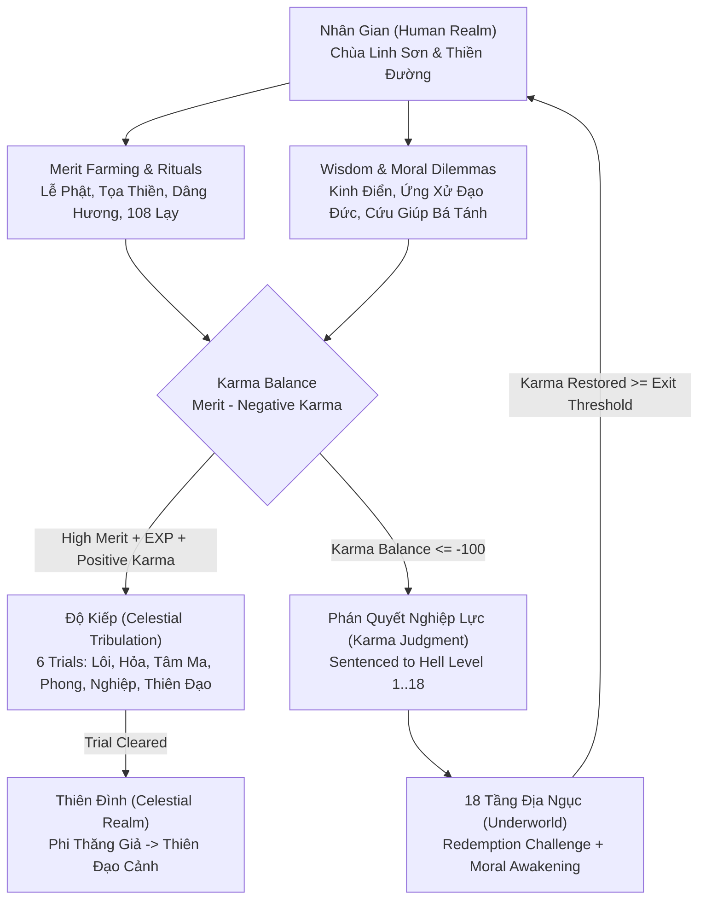

# Luân Hồi Online — Game Design Document (GDD)

## 1. Executive Vision & Design Pillars

**Luân Hồi Online** is a browser-based 3D social multiplayer RPG inspired by Buddhist philosophy, Vietnamese and East Asian folk mythology, causal karma (*Nhân Quả*), celestial cultivation (*Tu Tiên / Độ Kiếp*), and the redemptive trials of the Eighteen Levels of Hell (*18 Tầng Địa Ngục*).

### Core Design Pillars
1. **Mindful Social Cultivation**: Players gather in sacred 3D spaces—Chánh Điện (Main Temple), Thiền Đường (Meditation Hall), Nam Thiên Môn (Heavenly Court), and Underworld Sanctums—to practice mindfulness, offer incense, chant sutras, and support fellow practitioners (*Đạo Hữu*).
2. **Living Law of Cause & Effect (*Nhân Quả Công Bằng*)**: Every action leaves a trace on the player's Karma Ledger. Compassionate deeds accumulate **Công Đức (Merit)**; harmful or selfish choices in moral dilemmas accumulate **Nghiệp Lực (Negative Karma)**.
3. **Redemption Over Permanent Punishment (*Quay Đầu Là Bờ*)**: Falling into the Eighteen Levels of Hell (`karmaBalance <= -100`) is never a dead end. Each level of Hell is a bespoke atmospheric realm with a pedagogical challenge and moral reflection that guides the player back to balance (`karmaBalance >= 0`).
4. **Zero Pay-to-Win Ethics**: Merit (*Công Đức*) and spiritual rank cannot be bought with real money under any circumstance. All currencies (**Sen** and **Tiên Ngọc**) are earned strictly through gameplay, wisdom learning, tribulations, and community harmony.

---

## 2. Core Gameplay Loops

### Loop 1: Daily Spiritual Practice & Merit Farming (Vòng Lặp Tích Đức)
- Players explore the Human Realm temple grounds and perform 12 distinct spiritual activities (`bow_buddha`, `meditate_session`, `prayer_beads`, `offer_incense`, `offer_lotus`, `read_scripture`, `listen_dharma`, `help_npc`, `group_meditation`, `offer_lantern`, `clean_temple`, `prostration_108`).
- Each activity triggers character animations, 3D visual effects (`golden_particles`, `lotus_bloom`, `bell_ripple`, `incense_smoke`, `sky_lantern`, `aura_surge`), and awards **Công Đức (Merit)**, **EXP**, and **Sen**.

### Loop 2: Wisdom Learning & Moral Dilemmas (Vòng Lặp Trí Tuệ & Khảo Nghiệm Đạo Tâm)
- Players study curated Buddhist & folk ethical teachings (Four Noble Truths, Eightfold Path, Five Precepts, Compassion, Forgiveness, Mindfulness, Impermanence, Non-attachment, Karma Causality, Gratitude).
- Interactive NPC encounters present three-way moral choices:
  - **Compassionate (`compassionate`)**: Grants significant **Công Đức** and **EXP**, reinforcing positive karma.
  - **Neutral (`neutral`)**: Grants modest **EXP** with minimal karmic shift.
  - **Harmful (`harmful`)**: Inflicts **Nghiệp Lực (Negative Karma)** for deceit, greed, wrath, or cruelty, pushing the player toward Underworld judgment.

### Loop 3: Celestial Ascension & Tribulations (Vòng Lặp Độ Kiếp Phi Thăng)
- Reaching Ranks 7 through 12 requires not only EXP, Merit, and positive Karma Balance, but also surviving one of the **6 Celestial Tribulations** (`trib_lightning` through `trib_final_heavenly`) in the Tribulation Arena.
- Fellow players can gather around the arena to chant, release lotus lanterns, and share protective auras.

### Loop 4: Karma Judgment & 18 Levels of Hell Redemption (Vòng Lặp Phán Quyết & Chuộc Tội)
- Whenever a player's `karmaBalance` drops to **`<= -100`**, the **Underworld Judgment Engine** immediately triggers a server-wide/room broadcast (`karma_judgment_triggered`) and transports the player to the corresponding level of the **18 Levels of Hell** (`hellSentenceLevel` 1 to 18).
- Normal realm travel is locked until the player completes the Warden NPC's **Redemption Challenge** and chooses an awakened moral reflection, restoring their `karmaBalance` to `>= 0` (or climbing step-by-step from deeper hells back to the surface).

### Loop 5: Sangha Community Rituals (Vòng Lặp Cộng Tu Đạo Tràng)
- All players in a room contribute simultaneously to live **Community Events** (`prostration_108`, `collective_meditation`, `lotus_lantern_festival`, `temple_cleaning`), unlocking shared Merit bursts and temple-wide visual celebrations upon completion.

---

## 3. Player Progression: 12 Spiritual & Celestial Stages

Players progress through **Levels 1–100** via EXP:
$$\text{Level} = \min\left(100, \max\left(1, \left\lfloor 1 + \sqrt{\frac{\text{EXP}}{3}} \right\rfloor\right)\right)$$

Simultaneously, players ascend through **12 Rank Stages** (`rankStage` 1..12). Ranks 1–6 take place in the **Human Realm (Nhân Gian)**; Ranks 7–12 unlock the **Celestial Realm (Thiên Đình)** via Tribulation trials.

| Stage | Vietnamese Title | English Title | Min EXP | Min Merit | Min Karma Balance | Required Tribulation | Celestial Access | Aura Color |
| :--- | :--- | :--- | :---: | :---: | :---: | :--- | :---: | :---: |
| **1** | **Phàm Nhân** | Mortal Seeker | 0 | 0 | -99 | *None* | No | `#d4c5a9` |
| **2** | **Thiện Tín** | Devout Believer | 100 | 80 | 50 | *None* | No | `#e8d882` |
| **3** | **Tu Hành Giả** | Dharma Practitioner | 300 | 250 | 180 | *None* | No | `#f0c451` |
| **4** | **Tích Đức Giả** | Merit Cultivator | 650 | 550 | 450 | *None* | No | `#f5a623` |
| **5** | **Hành Giả Tinh Tấn** | Diligent Ascetic | 1,200 | 1,000 | 850 | *None* | No | `#69d2e7` |
| **6** | **Cận Siêu Thoát** | Threshold of Transcendence | 2,000 | 1,800 | 1,500 | *None* | No | `#a7dbd8` |
| **7** | **Phi Thăng Giả** | Ascended Spirit | 3,200 | 3,000 | 2,600 | `trib_lightning` | **Yes** | `#7ef9ff` |
| **8** | **Tiên Nhân** | Celestial Immortal | 5,000 | 4,500 | 4,000 | `trib_fire` | **Yes** | `#ff9de2` |
| **9** | **Chân Tiên** | True Immortal | 7,500 | 6,800 | 6,000 | `trib_heart_demon` | **Yes** | `#c58af9` |
| **10** | **Kim Tiên** | Golden Immortal | 11,000 | 10,000 | 9,000 | `trib_wind` | **Yes** | `#ffd700` |
| **11** | **Đại La Kim Tiên** | Great Golden Immortal | 16,000 | 15,000 | 13,500 | `trib_karma` | **Yes** | `#ffae00` |
| **12** | **Thiên Đạo Cảnh** | Heavenly Dao Sovereign | 25,000 | 24,000 | 22,000 | `trib_final_heavenly` | **Yes** | `#ffffff` |

---

## 4. Merit & Karma Mechanics, Formulas & Anti-Bot Rules

### 4.1 Core Karma Formula
Every player maintains three tracked values on their `PlayerProfile`:
- **Total Merit (`merit`)**: Cumulative positive spiritual credit earned through virtuous deeds (`>= 0`).
- **Total Negative Karma (`negativeKarma`)**: Cumulative karmic debt from harmful moral choices or transgressions (`>= 0`).
- **Net Karma Balance (`karmaBalance`)**:
$$\text{Karma Balance} = \text{Total Merit} - \text{Total Negative Karma}$$

Whenever a player completes a redemption ritual in the Underworld, their `negativeKarma` is reduced (or offset by redemptive merit) and recorded as an immutable `KarmaTransaction` entry in `karmaLedger`.

### 4.2 Activity Cooldowns, Daily Soft Caps & Diminishing Returns
To encourage mindful variety rather than macro spamming of a single button, every activity enforces:
1. **Action Cooldown (`cooldownMs`)**: Server-enforced minimum interval between executions (ranging from `2,500ms` to `8,000ms`).
2. **Daily Soft Cap (`dailySoftCap`)**: Full rewards are granted while `dailyActionCounts[activityId] < dailySoftCap`.
3. **Stepped Diminishing Returns (`diminishingFactor`)**: Once `dailyActionCounts[activityId] >= dailySoftCap`, rewards scale down exponentially per half-cap step, floored at `20%` (`0.2x`) of base value so players are never completely blocked from roleplaying:
$$\text{step} = \left\lfloor \frac{\text{count} - \text{softCap}}{\max(1, \lfloor \text{softCap} / 2 \rfloor)} \right\rfloor + 1$$
$$\text{multiplier} = \max\left(0.20, (\text{diminishingFactor})^{\text{step}}\right)$$

### 4.3 Full Merit Activity Balance Table

| Activity ID | Vietnamese Name | Base Merit | Base EXP | Sen Reward | Cooldown (ms) | Daily Soft Cap | Diminishing Factor | Min Rank | VFX Type |
| :--- | :--- | :---: | :---: | :---: | :---: | :---: | :---: | :---: | :--- |
| `bow_buddha` | Lễ Phật Thành Tâm | 8 | 10 | 2 | 2,500 | 40 | 0.5 | 1 | `golden_particles` |
| `meditate_session` | Toạ Thiền Định Tâm | 14 | 18 | 4 | 4,000 | 30 | 0.5 | 1 | `lotus_bloom` |
| `prayer_beads` | Lần Chuỗi Niệm Phật | 10 | 12 | 3 | 3,000 | 35 | 0.5 | 1 | `bell_ripple` |
| `offer_incense` | Dâng Hương Trầm | 12 | 15 | 3 | 3,500 | 25 | 0.5 | 1 | `incense_smoke` |
| `offer_lotus` | Dâng Hoa Sen Thanh Khiết | 16 | 20 | 5 | 4,000 | 20 | 0.5 | 1 | `lotus_bloom` |
| `read_scripture` | Tụng Kinh Khai Trí | 18 | 25 | 5 | 4,500 | 20 | 0.5 | 2 | `golden_particles` |
| `listen_dharma` | Thính Pháp Giác Ngộ | 22 | 30 | 6 | 5,000 | 15 | 0.5 | 2 | `bell_ripple` |
| `help_npc` | Cứu Giúp Bá Tánh | 25 | 32 | 8 | 5,000 | 15 | 0.5 | 1 | `golden_particles` |
| `group_meditation` | Cộng Tu Thiền Định | 30 | 38 | 10 | 6,000 | 15 | 0.5 | 2 | `aura_surge` |
| `offer_lantern` | Thả Đèn Hoa Đăng | 20 | 24 | 7 | 4,500 | 20 | 0.5 | 1 | `sky_lantern` |
| `clean_temple` | Quét Lá Chùa Xưa | 15 | 20 | 5 | 3,500 | 25 | 0.5 | 1 | `golden_particles` |
| `prostration_108` | Đại Lễ 108 Lạy Sám Hối | 45 | 55 | 15 | 8,000 | 10 | 0.4 | 3 | `aura_surge` |

### 4.4 Underworld Karma Judgment Thresholds (18 Levels of Hell)
- **Warning State**: `-99 <= karmaBalance <= -50` triggers a visual karmic warning aura (`karmic_fire`) and gentle reminders from temple monks.
- **Judgment Trigger**: `karmaBalance <= -100` immediately sentences the player to the deepest matching Hell Level in `KARMA_JUDGMENT_CONFIG`:

| Hell Level | Vietnamese Name | English Subtitle | Karma Threshold | Exit Karma Target | Core Moral Failing (Theme Sin) |
| :---: | :--- | :--- | :---: | :---: | :--- |
| **1** | Bạt Thiệt Địa Ngục | Chamber of Deceitful Words | `<= -100` | `0` | Deceit, divisive gossip,dishonest speech |
| **2** | Tiễn Đao Địa Ngục | Dunes of Insatiable Greed | `<= -220` | `-80` | Selfish greed, seizing others' livelihoods |
| **3** | Thiết Thụ Địa Ngục | Forge of Wrathful Discord | `<= -360` | `-180` | Blind rage, sowing family/community hatred |
| **4** | Nghiệt Kính Địa Ngục | Hall of the Karmic Mirror | `<= -520` | `-300` | Hypocrisy, concealing wrongdoing |
| **5** | Chưng Lung Địa Ngục | Chasm of Broken Oaths | `<= -700` | `-450` | Betraying sacred promises and trust |
| **6** | Đồng Trụ Địa Ngục | Glacier of Cruel Apathy | `<= -900` | `-620` | Cold-hearted indifference to suffering |
| **7** | Đao Sơn Địa Ngục | Ridge of Malicious Slander | `<= -1100` | `-800` | Malicious slander ruining innocent lives |
| **8** | Băng Sơn Địa Ngục | Vault of Stolen Offerings | `<= -1300` | `-1000` | Embezzling charity or sacred offerings |
| **9** | Dầu Oa Địa Ngục | Arena of Bullying & Violence | `<= -1500` | `-1200` | Oppressing the weak and vulnerable |
| **10** | Ngưu Khanh Địa Ngục | Maze of Fraud & Manipulation | `<= -1720` | `-1400` | Calculated fraud and manipulation |
| **11** | Thạch Áp Địa Ngục | Grove of Filial Ingratitude | `<= -1950` | `-1620` | Ingratitude toward parents and benefactors |
| **12** | Xuân Cối Địa Ngục | Spire of Arrogant Hubris | `<= -2200` | `-1850` | Extreme hubris and contempt for all beings |
| **13** | Huyết Trì Địa Ngục | Ruins of Communal Sabotage | `<= -2450` | `-2100` | Destroying shared sanctuaries and nature |
| **14** | Vong Tử Thành Địa Ngục | Mire of Corrupted Trust | `<= -2700` | `-2350` | Leading others into despair and ruin |
| **15** | Đao Cứ Địa Ngục | Court of Unjust Exploitation | `<= -2950` | `-2600` | Corrupting justice for personal gain |
| **16** | Hỏa Xa Địa Ngục | Fog of Wilful Ignorance | `<= -3150` | `-2850` | Knowing the harm yet obstinately repeating it |
| **17** | Bàn Thạch Địa Ngục | Abyss of Obsessive Attachment | `<= -3320` | `-3050` | Clinging to multi-lifetime vendettas |
| **18** | A Tỳ Đại Địa Ngục (Avīci) | Sanctum of Ultimate Reckoning | `<= -3500` | `-3250` | Gravest offenses against compassion and truth |

---

## 5. The 6 Celestial Tribulations (Độ Kiếp Phi Thăng)

To ascend into and within **Thiên Đình (Celestial Realm)**, players enter the **Tribulation Arena (`tribulation_arena`)** and face six progressive trials:

| ID | Vietnamese Name | Type | Req. Stage | unlocks Stage | Duration | Party Size | Hazard Mechanic | Rewards (Merit / EXP / Tiên Ngọc) | Unlocked Aura & Title |
| :--- | :--- | :--- | :---: | :---: | :---: | :---: | :--- | :---: | :--- |
| `trib_lightning` | **Cửu Trùng Lôi Kiếp** | `lightning` | 6 | **7** | 45s | 2 | Ground lightning telegraphs every 5s; meditate inside Lotus nodes to reduce shock by 70%. | 250 / 350 / 25 | `aura_thunder_lotus` *Lôi Kiếp Phi Thăng Giả* |
| `trib_fire` | **Hồng Liên Hỏa Kiếp** | `fire` | 7 | **8** | 50s | 2 | Expanding rings of karmic fire; nearby allies chant Cam Lộ mantras to cool inner heat. | 400 / 550 / 40 | `aura_crimson_lotus` *Hồng Liên Tiên Nhân* |
| `trib_heart_demon` | **Vô Tướng Tâm Ma Kiếp** | `heart_demon` | 8 | **9** | 60s | 3 | Shadow illusions test the player's mindfulness with rapid moral riddles. | 650 / 850 / 60 | `aura_mirror_wisdom` *Bất Động Chân Tiên* |
| `trib_wind` | **Cửu Thiên Phong Kiếp** | `wind` | 9 | **10** | 65s | 3 | Astral gales push players off the altar; link protective mudras with allies to anchor. | 950 / 1200 / 90 | `aura_golden_immortal` *Bất Hoại Kim Tiên* |
| `trib_karma` | **Vạn Kiếp Nghiệp Lực Kiếp** | `karma` | 10 | **11** | 75s | 4 | Karmic chains manifest past debts; perform Merit Dedication (*Hồi Hướng*) to dissolve them. | 1400 / 1800 / 130 | `aura_dharma_wheel` *Đại La Vô Thượng Tiên* |
| `trib_final_heavenly` | **Hỗn Nguyên Thiên Đạo Đại Kiếp** | `final_heavenly` | 11 | **12** | 90s | 5 | Five-phase synthesis of Lightning, Fire, Heart Demon, Wind, and Karma supported by the whole room. | 2200 / 3000 / 250 | `aura_heavenly_dao` *Thiên Đạo Chí Tôn* |

---

## 6. Non-Pay-To-Win Economy & Cosmetic Catalog

### 6.1 Five Core Currencies & Metrics
1. **Công Đức (Merit)**: Earned via temple activities, quests, compassionate choices, and community events. Required for Rank progression and Karma Balance. **Cannot be traded or bought.**
2. **Nghiệp Lực (Negative Karma)**: Accumulated only through harmful moral choices or destructive behavior. Reduced through repentance rituals and Underworld redemption.
3. **Kinh Nghiệm (EXP)**: Measures spiritual experience and drives Player Level (`1..100`) and Rank eligibility.
4. **Sen (Lotus Currency)**: Earned from daily/weekly quests, spiritual activities, and achievements. Used to unlock traditional robes, accessories, and gentle auras.
5. **Tiên Ngọc (Celestial Jade)**: High-prestige currency earned exclusively from Achievements and clearing Celestial Tribulations. Used to unlock immortal vestments, radiant Dharma halos, and celestial titles.

### 6.2 Cosmetic Categories
All items in `COSMETIC_CATALOG` provide **zero gameplay stat advantages**:
- **Outfits (`outfit`)**: *Áo Lam Hành Hương* (Free starter), *Huỳnh Y Giải Thoát* (45 Sen), *Bạch Liên Tinh Khiết Y* (90 Sen), *Ngọc Thanh Hộ Pháp Bào* (160 Sen + 15 Tiên Ngọc), *Cửu Vân Tiên Y* (280 Sen + 45 Tiên Ngọc), *Kim Quang Thiên Đạo Bào* (500 Sen + 120 Tiên Ngọc).
- **Auras (`aura`)**: *Hào Quang Hương Trầm*, *Liên Hoa Bảo Quang*, *Thanh Lôi Tiên Quang*, *Kim Luân Pháp Quang*, *Hỗn Nguyên Đại Đạo Quang*.
- **Accessories (`accessory`)**: *Tràng Hạt Bồ Đề 108 Hạt* (`mala_beads`), *Lư Hương Đồng Chạm Rồng* (`incense_censer`), *Mão Liên Hoa Phát Quang* (`lotus_halo`), *Huyền Thiên Phi Bạc* (`celestial_ribbon`), *Tích Trượng Cửu Hoàn* (`dharma_staff`).
- **Titles & Nameplates (`title`)**: Unlockablejade, gold, and celestial nameplate styles (*Tâm Sen Thanh Tịnh*, *Từ Bi Hành Giả*, *Thiên Đình Sứ Giả*).

---

## 7. Quests, Achievements & Community Events

### 7.1 Quest System (`QUEST_DEFINITIONS`)
- **Daily Quests (`daily`)**: Reset every 24 hours; guide players through a balanced 10–15 minute routine (*Nén Hương Tâm Thành*, *Tĩnh Lặng Giữa Dòng Đời*, *Chín Lạy Kính Lễ Tam Bảo*, *Quét Sân Tịnh Cảnh*, *Bàn Tay Từ Bi*).
- **Weekly Quests (`weekly`)**: Encourage deeper social participation (*Đại Nguyện 108 Lạy*, *Đạo Tràng Cộng Tu*, *Đêm Hội Hoa Đăng*).
- **Story Quests (`story`)**: Milestone quests tied to Rank gates (`quest_story_first_wisdom`, `quest_story_compassion_trial`, `quest_story_celestial_gate`, `quest_story_lotus_pond`, `quest_story_heart_mirror`, `quest_story_karmic_resolver`, `quest_story_supreme_awakening`).
- **Redemption Quests (`redemption`)**: Repeatable Underworld awakening quest (`quest_redemption_repentance`) that guides sentenced players back to the Human Realm.

### 7.2 Achievements (`ACHIEVEMENT_DEFINITIONS`)
10 milestone achievements tracking Merit (`10`, `1,000`, `10,000`), Meditation sessions (`25`), 108 Prostrations (`10`), Wisdom lessons (`10`), Celestial Ascension (`Stage 7`), Underworld Redemption (`1`), Community Contributions (`15`), and Supreme Awakening (`Stage 12`). Each grants **Sen**, **Tiên Ngọc**, and an exclusive honorary title.

### 7.3 Synchronized Community Events (`CommunityEventState`)
Rooms cycle through four cooperative Sangha rituals where every participant's action increments the shared progress bar:
1. **Đại Lễ 108 Lạy Đồng Tâm (`prostration_108`)**: Players bow and prostrate together in front of the Main Altar until 108 collective prostrations are reached (`+120 Bonus Merit` to all contributors).
2. **Thiền Định Cộng Hưởng (`collective_meditation`)**: Players sit on lotus cushions in the Meditation Hall, building a golden harmonic dome (`+100 Bonus Merit`).
3. **Đêm Hội Hoa Đăng Liên Hoa (`lotus_lantern_festival`)**: Players release floating lanterns across the sacred pond, illuminating the night sky (`+110 Bonus Merit`).
4. **Thanh Tịnh Già Lam (`temple_cleaning`)**: Players sweep fallen Bodhi leaves and purify the courtyard together (`+90 Bonus Merit`).
