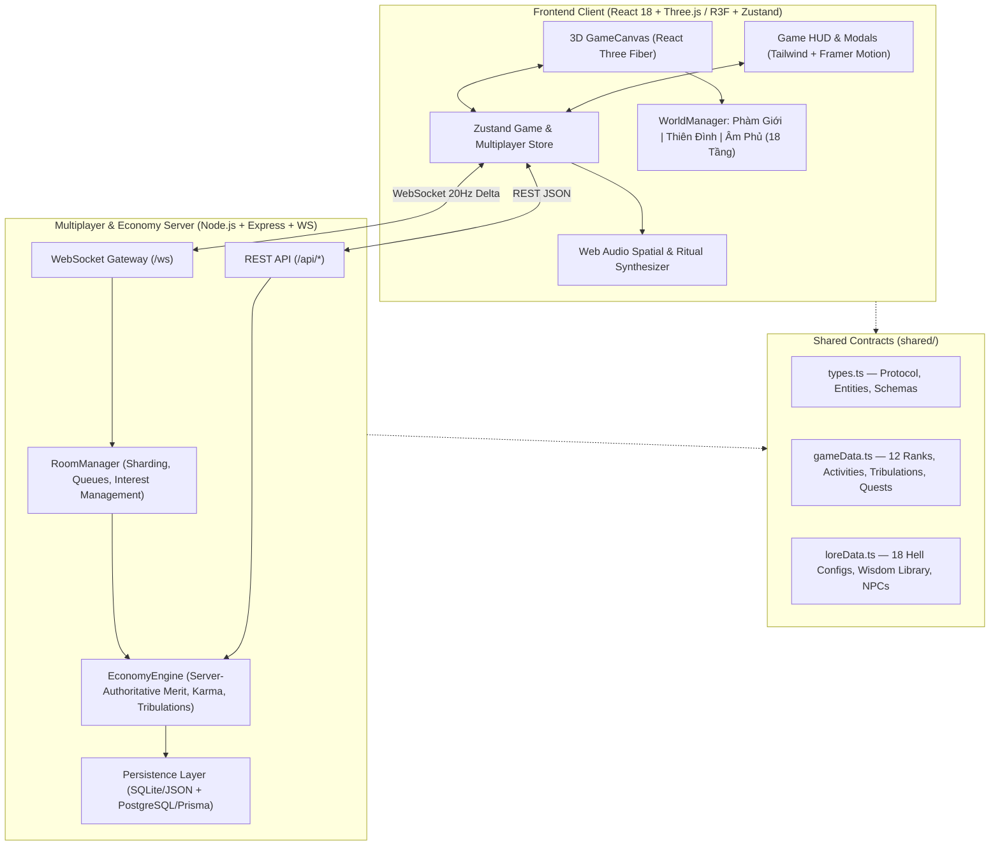

# Technical Architecture — Luân Hồi Online

## 1. System Overview
Luân Hồi Online uses a unified TypeScript monorepo architecture separating shared contracts (`shared/`), the 3D WebGL React client (`src/`), and the server-authoritative multiplayer & economy backend (`server/`).

## 2. Module Boundaries & File Ownership
- `shared/types.ts`: Single source of truth for all entity shapes, WebSocket packets, and REST payloads.
- `shared/gameData.ts`: Data-driven tables for the 12 cultivation stages, 12 merit activities, 6 celestial tribulations, daily/weekly quests, achievements, and cosmetics.
- `shared/loreData.ts`: Complete configurations for all 18 Levels of Hell, Wisdom Library entries, moral dilemmas, and NPC dialogues.
- `server/database.ts` & `prisma/schema.prisma`: Persistence engine supporting zero-config local transactional storage with full PostgreSQL + Redis Docker deployment support.
- `server/economyEngine.ts`: Server-authoritative validation for cooldowns, daily soft caps, diminishing returns, net karma calculation, automatic underworld sentencing, hell redemption, and ascension trials.
- `server/roomManager.ts`: Manages public rooms, capacity limits (50–100 players/room), waiting queues, auto-sharding, spatial interest filtering (broadcasting nearby players within interest radius), and community ritual synchronization.
- `src/scene/*`: Modular 3D scene graph separating `GameCanvas`, `WorldManager`, `HumanRealm`, `CelestialRealm`, `UnderworldRealm`, `PlayerController`, `RemotePlayers`, and `CharacterModel`.
- `src/ui/*`: Non-blocking game HUD and contextual modals (`MainHUD`, `Cinematics`, `WisdomModal`, `HellLedgerModal`, `TribulationModal`, `QuestsAndEventsModal`, `SocialAndShopModal`).
